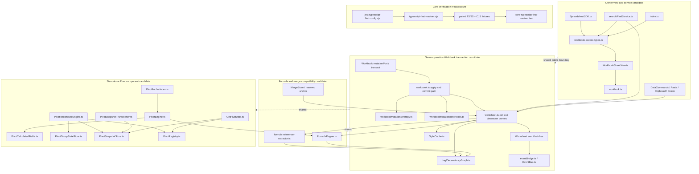

# CS-002D4-R1 PKG-17A — Core candidate dependency graph

**Baseline:** `88b09634f17f3b39d88a88c5428f76b426459a2b`
**Purpose:** Describe dependencies visible from current Core imports and existing package evidence so review units can be composed without treating a shared file as an independently attributable patch. This graph is source/review evidence, not authorization or proof that a candidate can be cleanly extracted from the accumulated worktree.

## Graph legend

- `A -> B`: current source imports/calls through the boundary, or the cited tests exercise the edge.
- `shared`: a file participates in more than one candidate unit and is a conflict boundary.
- `evidence`: a report/test directly supports the named behavior, but does not prove source hunk authorship.
- `ambiguous`: no retained package-level commit/patch establishes exact hunk origin.

## Candidate dependency graph

## Dependency and evidence register

| Candidate unit | Core paths / manifest family | Direct source dependency evidence | Existing tests and package reports | Shared conflicts and review boundary |
| --- | --- | --- | --- | --- |
| Seven-operation Workbook transaction | `workbook.ts`, `worksheet.ts`, `dag/DependencyGraph.ts`, `EventBus.ts`, `events.ts`, `workbookMutationStrategy.ts`, `workbookMutationTestHooks.ts`; 96 tracked hunks across the first five files plus two added source-file records | `workbook.ts` imports `worksheet.ts`, `EventBus.ts`, the mutation hooks and strategy, plus `DependencyGraph` address constants. `worksheet.ts` imports the graph, stores, style cache and event emitter. Graph journal methods own graph before-images. | `workbook-row-height-journal.p1-pkg-02a.test.ts`, `workbook-column-width-journal.p1-pkg-02b.test.ts`, `workbook-seven-operation-differential.p1-pkg-02c.test.ts`, `workbook-transaction-side-effect-matrix.p1-pkg-13b.test.ts`, `workbook-transaction-disposal-publication.p1-pkg-14b.test.ts`, `workbook-multisheet-formula-graph-rollback.p1-pkg-15b.test.ts`; PKG-14B/15B reports. | `workbook.ts`/`worksheet.ts` overlap formula, merge, lifecycle, Pivot and comments. Journal default/test hook files are untracked at HEAD; package-specific sections cannot be extracted without patch provenance. D2-11 remains globally open. |
| Formula and merged-coordinate behavior | `FormulaEngine.ts` (21), `FormulaController.ts` (6), `ConditionalFormattingFormulaCompiler.ts` (2), with shared `worksheet.ts` and graph dependencies | Worksheet imports `extractFormulaDependencies`, `FormulaEngine`/formula integration, MergeStore and DependencyGraph. The tested A1 evaluator and dependency extractor are distinct code paths. | `workbook-merged-member-formula-origin.p1-pkg-13a.test.ts`, `workbook-merged-formula-coordinate-contract.p1-pkg-14a.test.ts`, `formula-a1-dollar-compatibility.p1-pkg-15a.test.ts`; PKG-15A analysis and PKG-16C decision. | Formula syntax, `$` compatibility and merged-member reference origin remain contract decisions. Transaction work must consume this cluster as a dependency, not silently redefine it. |
| Standalone Pivot components | Eight component files: `PivotEngine.ts`, `PivotCalculatedFields.ts`, `PivotRecomputeEngine.ts`, `PivotGroupStateStore.ts`, `PivotSnapshotStore.ts`, `PivotSnapshotTransformer.ts`, `PivotAnchorIndex.ts`, `GetPivotData.ts`; 72 hunks | `PivotEngine.ts` imports FormulaEngine, calculated-field engine and group state. Recompute imports registry/snapshot/group types. Transformer imports Pivot config/snapshot types. `GetPivotData` reads registry, snapshot and recompute abstractions. Workbook imports these components, but the public lifecycle path remains gated. | `pivot-partial-recompute-safety.p1-08x.test.ts`, `pivot-recompute-validation-retry.p1-pkg-14c.test.ts`, `pivot-error-publication.p1-pkg-13c.test.ts`, standalone Pivot engine/snapshot/recompute tests; PKG-15C and PKG-16D. | Keep component reliability separate from Workbook-owned Pivot lifecycle. `workbook.ts` is a shared integration conflict; no private registry/store exposure or lifecycle API is implied. |
| Commands and service callers | `commands/DataCommands.ts` (99), `search/FindService.ts` (41), `ClipboardService.ts` (7), `PasteCommand.ts` (7), `DeleteCellsCommand.ts` (3) | DataCommands imports Worksheet and DependencyGraph address validation. FindService imports Worksheet and WorkbookSheetView types. PasteCommand imports Worksheet, ClipboardService and FormulaShiftingService. | Existing Core command/service tests and P1-08 command/owner-boundary tests; PKG-16A change dependency map and PKG-16F leadership packet. | `DataCommands.ts` is the largest single cluster and spans distinct commands. These hunks are not a seven-operation extension. Review by operation/caller with its own tests; exact package attribution remains ambiguous. |
| Owner views, SDK and public exports | `WorkbookSheetView.ts` (14), `workbook-access-types.ts` (2), `SpreadsheetSDK.ts` (3), `index.ts` (2) | WorkbookSheetView type imports Worksheet and owner access interfaces; Workbook constructs views and exports public API types. SDK is a separate façade. | Owner boundary tests and P1-08 evidence; PKG-10C/11C/16D for Workbook lifecycle limits. | Public surface changes can alter callers across React/framework packages; not independently mergeable from `workbook.ts` without complete import/API review. |
| Experimental calculation prototype | `experimental/WorkbookCalculationPrototype.ts` (3) | Isolated experimental module; no production dependency inferred from this diff review. | No relevant acceptance claim in the cited Core candidates. | Preserve as separate and unattributed until its owner identifies intended status. |
| Core TypeScript-first verification | 7 added Core config/resolver/test/fixture files (manifest `INFRA-*`) | Opt-in Core Jest config delegates to a custom resolver; resolver logic has paired source/runtime fixture cases exercised by the dedicated resolver test. | PKG-08A sidecar resolver report and test; PKG-16E candidate matrix/command. | This is verification infrastructure, not runtime product code. Existing configs remain separately scoped; no claim is made that every workspace uses the opt-in config. |

### Hunk family totals

The 378 tracked production-source hunks partition by primary review focus as follows; shared dependencies are called out above rather than counted twice:

| Primary review focus | Files / hunk count |
| --- | ---: |
| Transaction/ownership/event core (Workbook, Worksheet, DependencyGraph, EventBus, events) | 96 |
| Formula parser/evaluator/controller/compiler | 29 |
| Standalone Pivot components | 72 |
| Command/service callers | 157 |
| Public view/access type/SDK/barrel | 21 |
| Experimental prototype | 3 |
| **Total** | **378** |

The transaction group is 96 tracked hunks across `workbook.ts`, `worksheet.ts`, `DependencyGraph.ts`, `EventBus.ts`, and `events.ts` (21 + 37 + 26 + 11 + 1). The two untracked strategy/hook files are separate whole-file records.

## Candidate composition and ordering

1. **Core resolver support** is self-contained as verification infrastructure: opt-in config -> resolver -> paired fixtures -> resolver test. Keep it out of runtime production candidates and run it only in the serialized Lane E verification window.
2. **Seven-operation transaction core** is a coherent behavior/evidence family but not a path-isolated patch. Its source dependencies are shared with formula and Pivot. Review the hunk manifest and PKG-02–PKG-15 tests together; keep D2-11 open.
3. **Formula/merge and standalone Pivot** are separate technical candidates with distinct contract blockers. Both depend on shared Worksheet/graph source. Do not fold their contract-dependent behavior into transaction code.
4. **Commands/services and owner-view surfaces** should remain caller/operation scoped. The 99 DataCommands hunks and public owner-view changes are not safe to infer as a single implementation unit from their filenames.
5. **Experimental and uncertain provenance** remains isolated. No source file is staged, copied, or assigned to a release candidate by this graph.

## Limits

Edges above are based on current imports, known call paths, and named test evidence. The graph is not a static call-graph proof and not a claim that an isolated candidate was built or tested. No clean worktree was constructed, and no production/test files were changed. Overall CS-002D4-R1 acceptance remains **WITHHELD**.
